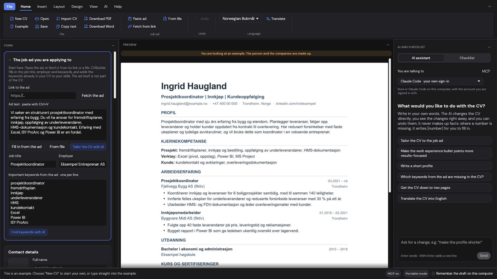
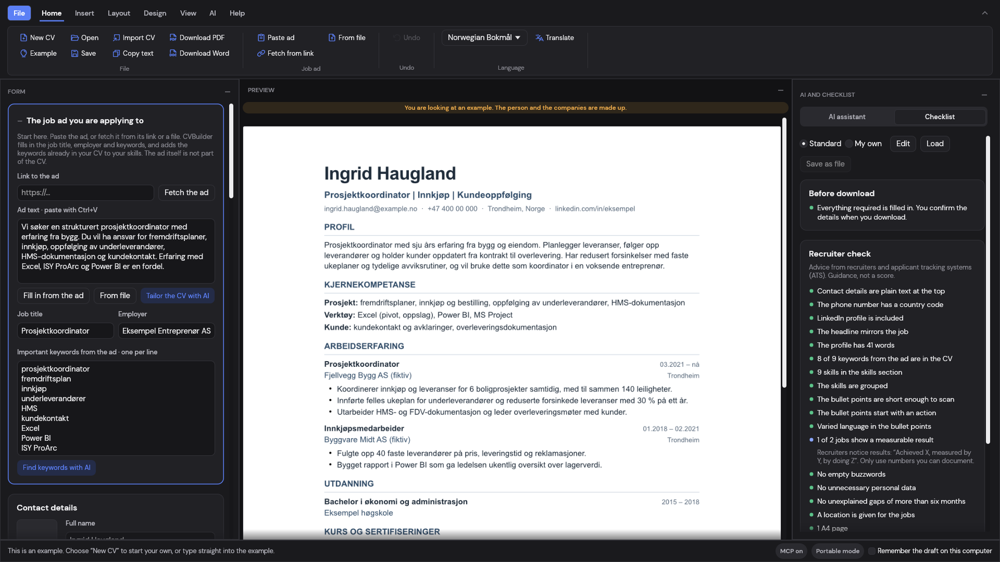

# CVBuilder

**A free CV builder that recruiters and applicant-tracking systems read correctly.**

Windows · Mac · Linux · 86 languages · works offline · free and open source

[**⬇️ Windows**](https://github.com/SoloSaftis/CVBuilder/releases/latest/download/CVBuilder-windows-x64-portable.zip) &nbsp;·&nbsp;
[**⬇️ Mac**](https://github.com/SoloSaftis/CVBuilder/releases/latest/download/CVBuilder-macos-arm64.zip) &nbsp;·&nbsp;
[**⬇️ Linux**](https://github.com/SoloSaftis/CVBuilder/releases/latest/download/CVBuilder-linux-x86_64.AppImage)

## What it does

- **Import your old CV** – Word, PDF, RTF, text and more, read offline into jobs, education and skills. Or start from scratch.
- **See the real pages while you type** – the preview is exactly the PDF and Word file you download.
- **Match the job ad** – paste the ad and see which of its keywords your CV is missing.
- **Recruiter checklist** – advice from recruiters and ATS, and what is missing before you send it.
- **31 designs**, your own colours and page layout. One column of real text, so every design reads the same in an ATS.
- **86 languages** for the menus and for the CV's headings and dates.
- **Saves like Word** – Ctrl+S, a reminder before closing, and autosave every 5 minutes.
- **Optional AI assistant** – Claude, ChatGPT, Gemini, Grok or a local model. You see every change and can undo it.

**Your CV stays on your computer.** No account, no ads, no tracking. Nothing is sent anywhere unless you connect an AI service yourself ([privacy policy](PRIVACY.md)).

## Download

| Your computer | Download | Then |
|---|---|---|
| **Windows** 10 or 11 | [⬇️ Download for Windows](https://github.com/SoloSaftis/CVBuilder/releases/latest/download/CVBuilder-windows-x64-portable.zip) | Open the folder and double-click **CVBuilder** |
| **Mac** with Apple chip (M1 or newer) | [⬇️ Download for Mac](https://github.com/SoloSaftis/CVBuilder/releases/latest/download/CVBuilder-macos-arm64.zip) | Open it and drag **CVBuilder** to Applications |
| **Linux** | [⬇️ Download for Linux](https://github.com/SoloSaftis/CVBuilder/releases/latest/download/CVBuilder-linux-x86_64.AppImage) | Right-click → Properties → allow running as a program, then double-click it ([folder version](https://github.com/SoloSaftis/CVBuilder/releases/latest/download/CVBuilder-linux-x86_64-portable.tar.gz)) |

<b>Your computer warns you the first time?</b>

The app is not signed yet, so you may see a warning once:

- **Windows** says "Windows protected your PC": click **More info**, then **Run anyway**.
- **Mac** says Apple "could not verify" CVBuilder: click **Done**, open System Settings → Privacy & Security, scroll down and click **Open Anyway** next to CVBuilder.

All versions and what changed: [Releases](https://github.com/SoloSaftis/CVBuilder/releases).

## For developers

Building, tests, languages and the folder layout: [DEVELOPING.md](DEVELOPING.md). CVBuilder is also
an MCP server, so AI apps such as Claude Code can work on the open CV.

## Licence

[MIT](LICENSE-MIT) or [Apache-2.0](LICENSE-APACHE), at your option. A contribution you submit is
licensed the same way. Bundled components keep their own licences (`THIRD-PARTY.txt` in each
package); design remakes of Reactive Resume and RenderCV are MIT (see [DEVELOPING.md](DEVELOPING.md#designs)).
WordCraft and the Craft AI integrations are by the ArtCraft/storytold contributors.
[Code signing policy](CODE_SIGNING_POLICY.md): free code signing provided by
[SignPath.io](https://about.signpath.io), certificate by [SignPath Foundation](https://signpath.org).
