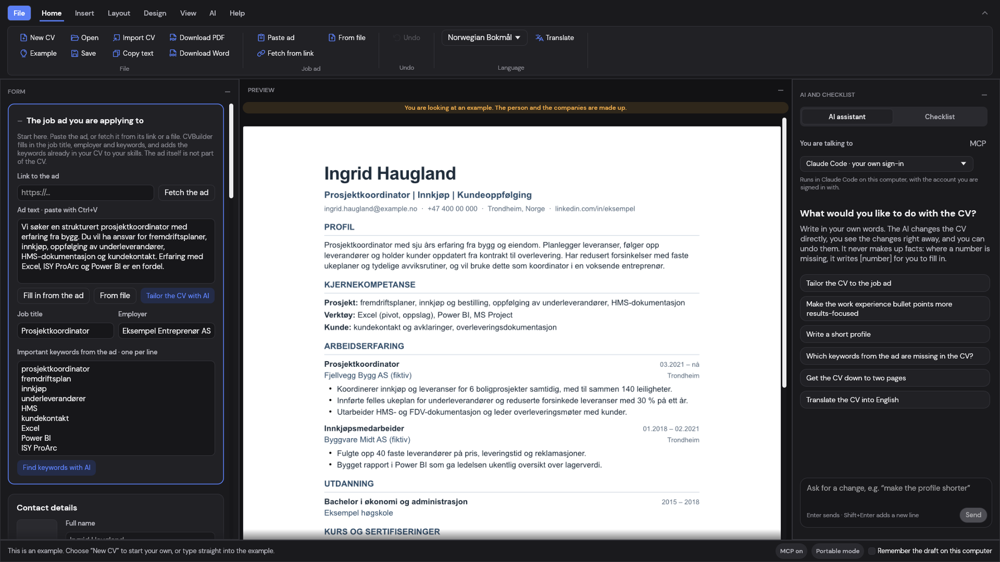

# CVBuilder user guide

CVBuilder is a free program that helps you write a CV that recruiters and
applicant tracking systems (ATS) read correctly. It runs on your own computer,
works without internet, and needs no account.

This guide is for job seekers. It explains every part of the program in plain
language.

## Start here

1. [Getting started](getting-started.md) – download, install, the first start,
   and where your CV is kept.
2. [Writing your CV](writing-your-cv.md) – the form, the live preview, photo,
   your own sections, undo and saving.

## Make it fit the job

3. [Importing an old CV and using the job ad](import-and-job-ads.md) – bring in
   a CV you already have, paste or fetch the job ad, and find its keywords.
4. [The checklist and downloading](checklist-and-export.md) – what recruiters
   look for, what is still missing, how to get your PDF or Word file, and
   filling in online application forms field by field.

## Make it look right

5. [Designs and colours](designs-and-colours.md) – 31 designs, your own
   colours, and your own design files.
6. [Languages](languages.md) – the language of the menus, the language of the
   CV, and translating your CV.

## Extra help

7. [The AI assistant](ai-assistant.md) – optional help from Claude, ChatGPT,
   Gemini, Grok, a model on your own computer, or Claude Code. Also: using
   CVBuilder from other AI apps (MCP).
8. [Updates and help](updates-and-help.md) – checking for a new version, the
   About window, and reporting a problem.
9. [Troubleshooting](troubleshooting.md) – warnings on first start, AI that
   will not connect, odd text in a PDF, and more.

## In short

- **Your CV stays on your computer.** Nothing is sent anywhere unless you ask
  for it: fetching a job ad from a link, checking for updates, or using an AI
  service you connected yourself. See the [privacy policy](../../PRIVACY.md).
- **What you see is what you get.** The preview shows the exact pages of the
  PDF and Word file you download.
- **You can always download.** If something important is missing, CVBuilder
  tells you first, and you decide.
- **Works in 86 languages**, both for the menus and for the CV's headings and
  dates.
- **Windows, Mac and Linux.** The current version is 1.0.1.

Found a problem or have a question? Open an issue at
<https://github.com/SoloSaftis/CVBuilder/issues>.
