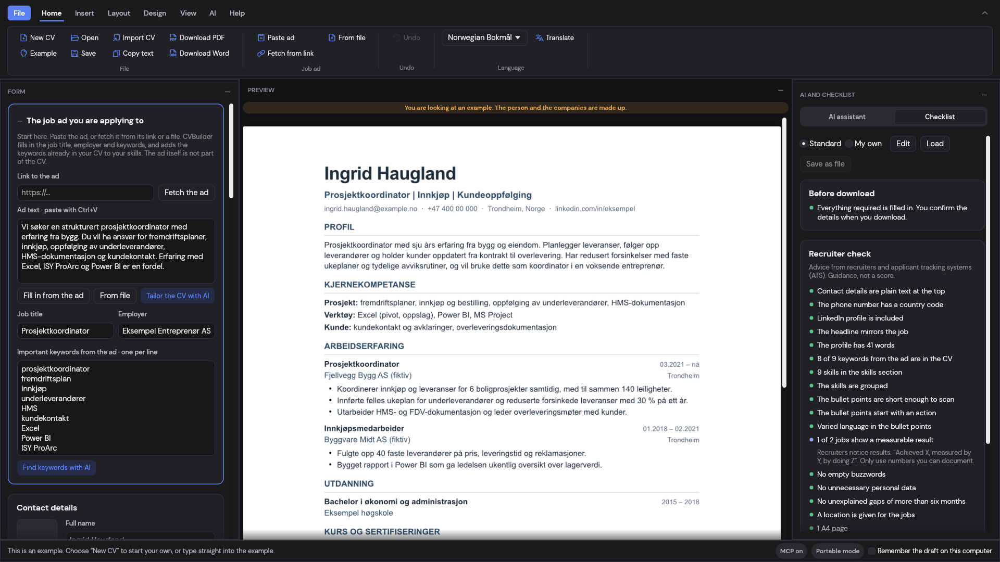

# The checklist and downloading

[Back to the user guide](README.md)

## The checklist

Open the checklist with the **Checklist** tab at the top of the right-hand
panel, or with **AI → Checklist**. When something important is missing, the tab
shows a number, for example **Checklist · 3**.

The checklist has two parts.

### Before download

This card shows what should be fixed before you send the CV:

- **Missing or wrong details** (red), for example:
  - full name, email, phone, city and country, or professional headline missing,
  - an email address or phone number that does not look right,
  - no job title for the job you are applying to,
  - no job or education at all,
  - a job without employer, job title, start date, end date or bullet points,
  - an end date before the start date,
  - an education without end year,
  - a profile longer than 90 words,
  - a link that does not start with `https://`,
  - placeholders left in the text, such as `[number]`, `[insert]` or `<…>`,
  - "Show photo" is on, but there is no photo.
- **Too many pages** – if the CV is longer than recruiters advise.
- **Two columns** – if the design has two columns, a warning that older
  applicant tracking systems (ATS) may read them in the wrong order.
- **Weak colours** – if text or headings are too light to read well.

When all is well, it says "Everything required is filled in."

### Recruiter check

This part gives advice from recruiters and applicant tracking systems. It is
guidance, not a score. Each point is green (fine), orange (worth fixing) or blue
(a tip). It checks, among other things:

- contact details at the top as plain text, and a phone number with country code,
- a LinkedIn profile,
- a headline that uses the job's own words,
- a profile of 30–70 words,
- how many of the ad's keywords are in your CV (aim for 70% or more),
- at least 6 skills, sorted into groups,
- bullet points that are short, start with an action, and vary their first word,
- jobs that show a measurable result,
- no empty buzzwords,
- no personal data that does not belong in a CV (date of birth, ID number,
  marital status, religion, nationality),
- gaps of more than six months between jobs,
- a location for each job,
- the number of pages.

Under **Keywords from the ad** you see which keywords are found (green) and
missing (orange). See [Keywords](import-and-job-ads.md#keywords).

### Your own checklist

You can use a checklist of your own instead of the built-in recruiter check.
For example, a list your career adviser gave you.

At the top of the checklist:

- **Standard** – the built-in recruiter check.
- **My own** – your own list.
- **Edit** – add, change, move and delete points.
- **Load** – use a list from a `.cvchecklist.json` file.
- **Save as file** – save your list to share or keep it.

In the **My checklist** window, each point is one of these kinds:

- **I tick it myself** – you tick it off. The tick is saved with this CV.
- **The CV mentions …** – CVBuilder checks that a word is in the CV. Separate
  several words with `/`.
- **The CV does not mention …** – CVBuilder checks that a word is *not* there.
- **At most this many pages** – the CV must not be longer.
- **The field is filled in** – a field such as name, headline, LinkedIn, photo
  or the job title must be filled in.

**Start from an example** gives you a list to build on. A list can have up to
100 points.

The **Before download** card is always shown, also with your own checklist.

## Downloading your CV

You can download from **File** or from the **Home** tab:

- **Download PDF** – a PDF with real, searchable text. This is the form
  applicant tracking systems read most reliably.
- **Download Word** – a Word file (`.docx`), for portals and recruiters that ask
  for Word.
- **Copy text** (**File → Copy the CV as text**) – copies the CV as plain text,
  for job portals that ask you to paste your CV into a box.

### What happens when you click download

Downloading always works. Before the file is saved, CVBuilder shows a short
window:

- **If something important is missing**, it says **Something important is
  missing from the CV** and lists what. You can:
  - **Download anyway** – save the file as it is,
  - **Show checklist** – go and fix it first,
  - **Cancel**.
- **If all is filled in**, it asks **Is everything in the CV correct?** and
  reminds you to read it through one last time: name, contact details, dates,
  and that everything is true – including what the AI wrote. Click
  **Yes, download**.

When you confirm, CVBuilder does not ask again for this CV until you change
something.

Then you choose where to save the file. CVBuilder suggests a name made from your
name, "CV" and the employer, for example `Kari_Nordmann_CV_Acme_en.pdf`.

### Before you send it

- Open the PDF and check every page.
- Open the Word file in Word and check the page breaks before you send it.
- If your CV is written in Arabic, Hebrew, Hindi or another script whose
  letters are joined or reordered, send the **Word** file to systems that read
  text. See [Troubleshooting](troubleshooting.md#copying-text-from-a-pdf-gives-scrambled-letters).

## Page layout

The **Layout** tab sets up the page, like in Word. Everything is saved with the
CV and shows in the preview right away.

### Page setup

- **Margins** – **Normal · 17 mm** (fits most CVs), **Narrow · 12.7 mm**,
  **Moderate · 19 / 25 mm**, **Wide · 25.4 mm**, or **Custom margins** in
  millimetres (5–40 mm).
- **Size** – **A4** (Europe and most of the world), **US Letter** or
  **US Legal** (USA and Canada).
- **Columns** – **As designed**, **One column (best for ATS)**, or two columns
  with a sidebar on the left or right. The sidebar gets contact details, skills,
  languages, courses and interests. Two columns can look good, but older
  applicant tracking systems may read them in the wrong order.

### Pages

- **New page** – choose sections that should start at the top of a new page
  (**Before**), or that should be followed by a page break (**After**). Use this
  so a section is not split badly. **Remove all page breaks** lets the sections
  flow freely again.
- **The page count and page target** – the tab shows how many pages the CV has
  now and how many are recommended, for example "2 pages · recommended 2".
  - One page is recommended for a short career (at most two jobs and less than
    about three years of work).
  - Two pages are recommended for most people.
  - There is no hard limit. The text turns orange or red when the CV is longer
    than recommended.

### Text and spacing

- **Smaller text / Larger text** (− and +) – change all text sizes in steps of
  half a point.
- **Spacing** – **Tight** (fits more), **Normal** or **Airy** (easier to read
  when the CV is short).
- **Reset** – back to the standard page setup.

To fit more on each page, you can also choose the design **Kompakt** (Compact).
See [Designs and colours](designs-and-colours.md).

## Next step

[Designs and colours](designs-and-colours.md)
